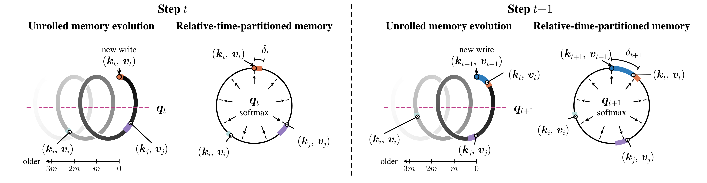

<div align="center">

# CyFA: Linear Sequence Modeling with Relative-Time-Partitioned Memory

**[Yixiao Chen](https://chyxx.github.io/) · Shuojin Yang · Shi-Min Hu**<br>
Tsinghua University

[](https://arxiv.org/abs/2609.36259) [](https://huggingface.co/collections/cyxxxxxxxxxx/cyclicflowattention-6abb56dc723179dddead18b0) [](https://zhuanlan.zhihu.com/p/2090817772250984628)

</div>

Official Jittor implementation of **Cyclic Flow Attention (CyFA)**, with training,
autoregressive generation and evaluation. CyFA organizes a fixed-size recurrent
memory by relative time, combining a learned clock and cyclic transport with
content-based softmax retrieval. An exact change to absolute-clock coordinates
yields two scalar-decay recurrences, enabling linear-time chunkwise training
and constant-memory autoregressive decoding.

The architecture and checkpoint format follow the
[PyTorch implementation](https://github.com/Chyxx/CyclicFlowAttention).

<p align="center">
  
</p>
<p align="center"><em>
Figure 1. CyFA advances stored associations through relative-time slots before
each new write. A learned clock controls the spacing between writes, while the
same transport keeps key and value memories aligned.
</em></p>

## Method

### Relative-time recurrence

Each head maintains aligned key and value memories. A learned clock increment
$\delta_t\in(0,1)$ transports both memories before the current pair is written
to the age-zero slot:

$$
\begin{aligned}
\mathbf K_t
&=\alpha_t\mathbf P(\delta_t)\mathbf K_{t-1}
+\beta_t\boldsymbol e_0\boldsymbol k_t^\top,\\
\mathbf V_t
&=\alpha_t\mathbf P(\delta_t)\mathbf V_{t-1}
+\beta_t\boldsymbol e_0\boldsymbol v_t^\top.
\end{aligned}
$$

Here $\mathbf P(\delta_t)$ is a fractional cyclic shift, $\alpha_t$ is a scalar
forget gate, and $\beta_t$ controls write strength. A learned matrix $\mathbf R$
combines relative-time slots during content-based retrieval:

$$
\boldsymbol o_t=(\mathbf R\mathbf V_t)^\top
\mathrm{softmax}\left(\mathbf R\mathbf K_t\boldsymbol q_t\right).
$$

### Absolute-clock recurrence

Let $\lambda_t=\lambda_{t-1}+\delta_t$ be the cumulative clock,
$\boldsymbol b=\boldsymbol\Phi^\top\boldsymbol e_0$, and $\mathcal U(\lambda)$ the
block-diagonal Fourier rotation associated with the cyclic shift. Moving the
state into absolute-clock coordinates removes the dense transport from the
recurrent transition exactly:

$$
\begin{aligned}
\overline{\mathbf K}_t
&=\alpha_t\overline{\mathbf K}_{t-1}
+\beta_t\mathcal U(-\lambda_t)\boldsymbol b\boldsymbol k_t^\top,\\
\overline{\mathbf V}_t
&=\alpha_t\overline{\mathbf V}_{t-1}
+\beta_t\mathcal U(-\lambda_t)\boldsymbol b\boldsymbol v_t^\top.
\end{aligned}
$$

The learned clock now controls only the temporal write vector; both stored
states advance through the scalar decay $\alpha_t$.

### Two-pass computation

The equivalent implementation consists of two scalar-gated linear-attention
passes connected by a token-wise softmax readout:

$$
\begin{aligned}
\{\boldsymbol o'_t\}_{t=1}^{T}
&=\mathrm{ScalarGatedLA}\left(
\{\boldsymbol q_t,\boldsymbol k_t,
\beta_t\mathcal U(-\lambda_t)\boldsymbol b,\alpha_t\}_{t=1}^{T}
\right),\\
\boldsymbol o''_t
&=\mathcal U(-\lambda_t)\boldsymbol\Phi^\top\mathbf R^\top
\mathrm{softmax}\left(
\mathbf R\boldsymbol\Phi\mathcal U(\lambda_t)\boldsymbol o'_t
\right),\\
\{\boldsymbol o_t\}_{t=1}^{T}
&=\mathrm{ScalarGatedLA}\left(
\{\boldsymbol o''_t,
\beta_t\mathcal U(-\lambda_t)\boldsymbol b,
\boldsymbol v_t,\alpha_t\}_{t=1}^{T}
\right).
\end{aligned}
$$

The first pass queries the key memory, the middle transformation produces
relative-time slot weights, and the second pass retrieves from the value
memory. Both recurrent passes admit parallel chunkwise training and fused
constant-memory decoding. The released models use 127 active slots, stored
with `num_slots=128` rows per head.

## Results and Checkpoints

The released checkpoints load directly through their model configuration and safetensors weights.

| Model | Config | Layers | Hidden size | Heads | Head dimension | Checkpoint |
| --- | --- | ---: | ---: | ---: | ---: | --- |
| CyFA-400M | [400M](configs/cyclic_flow_attention_400m.json) | 24 | 1024 | 4 | 256 | [15B tokens](https://huggingface.co/cyxxxxxxxxxx/cyfa-400M-15B) |
| CyFA-800M | [800M](configs/cyclic_flow_attention_800m.json) | 24 | 1536 | 6 | 256 | [30B tokens](https://huggingface.co/cyxxxxxxxxxx/cyfa-800M-30B) |
| CyFA-1.4B | [1.4B](configs/cyclic_flow_attention_1_4b.json) | 24 | 2048 | 8 | 256 | [100B tokens](https://huggingface.co/cyxxxxxxxxxx/cyfa-1.4B-100B) |

The checkpoints were pretrained with the original PyTorch implementation.

## Installation

Requirements: **Linux**, **Python 3.10–3.12**, **Jittor 1.3.11.0**, **CUDA 12.x with cuBLAS**, `g++`, and an **NVIDIA GPU with BF16 support (Ampere or newer)**.

```bash
git clone https://github.com/Chyxx/CyFA-Jittor.git
cd CyFA-Jittor
python -m venv .venv
source .venv/bin/activate
pip install -e '.[train,eval]'
export CUDA_HOME=/usr/local/cuda
export nvcc_path="$CUDA_HOME/bin/nvcc"
export JITTOR_HOME="$PWD/.cache/jittor"
export TMPDIR="$PWD/.cache/tmp"
mkdir -p "$TMPDIR"
```

Model execution uses Jittor throughout training, generation and evaluation. The `eval` extra provides the official lm-evaluation-harness task definitions.

Use separate environments for the Jittor and PyTorch repositories; both expose the `cyclic_flow_attention` package.

## Quick Start

### Generate from a checkpoint

```bash
CUDA_VISIBLE_DEVICES=0 python -m cyclic_flow_attention.generation \
  --model-path cyxxxxxxxxxx/cyfa-400M-15B \
  --prompt "The library opens at" --max-new-tokens 64
```

Generation uses a chunkwise prompt prefill followed by single-token recurrent decoding. Greedy decoding is the default; `--temperature 0.8 --top-p 0.9` enables sampling. Local checkpoint directories are accepted by every model-loading entry point.

```python
from cyclic_flow_attention import CyclicFlowAttentionForCausalLM
from cyclic_flow_attention.utils import setup_cuda

setup_cuda()
model = CyclicFlowAttentionForCausalLM.from_pretrained("path/to/checkpoint")
model.save_pretrained("outputs/export")
```

### As a layer

```python
import jittor as jt
from cyclic_flow_attention import CyclicFlowAttention

jt.flags.use_cuda = 1
jt.flags.use_tensorcore = 0
layer = CyclicFlowAttention(
    hidden_size=1024,
    num_heads=4,
    head_dim=256,
    num_slots=128,
).bfloat16()
x = jt.randn((1, 2048, 1024)).bfloat16()
y, cache = layer(x)
assert y.shape == x.shape
```

### Initialize a causal language model

```python
from cyclic_flow_attention.utils import initialize_model, read_config, setup_cuda

setup_cuda()
config = read_config("configs/cyclic_flow_attention_400m.json")
model = initialize_model(config)
```

## Data Preparation

```bash
python -m training.prepare_data \
  --dataset cerebras/SlimPajama-627B --split train --text-column text \
  --tokenizer fla-hub/gla-1.3B-100B --output-dir data/slimpajama
```

Documents are streamed, tokenized without automatic special tokens, separated by EOS and stored as a memory-mapped uint32 token file. `--input corpus.txt` and `--input corpus.jsonl` support local data. Prepare validation data separately with the same tokenizer. Training samples contiguous fixed-length token windows and never loads the entire token file into RAM.

## Training

Train the 400M architecture from scratch on one GPU:

```bash
CUDA_VISIBLE_DEVICES=0 python -m training.train \
  --config configs/cyclic_flow_attention_400m.json \
  --tokenizer fla-hub/gla-1.3B-100B --data data/slimpajama \
  --output-dir outputs/cyfa-400m --context-length 2048 \
  --batch-size 1 --gradient-accumulation-steps 32 \
  --learning-rate 3e-4 --warmup-steps 1024 --max-steps 30720
```

Training uses BF16 projections, FP32 normalization and readout parameters, FP32 master-weight AdamW, FP32 gradient accumulation, gradient clipping and cosine learning-rate decay. `--batch-size` is the microbatch per device; choose it to fit available activation memory. The effective batch is microbatch × accumulation × data-parallel ranks. The command above uses an effective batch of 32 sequences; the original eight-GPU 400M recipe uses 256.

Each `checkpoint-N` contains the model config, safetensors weights, tokenizer, FP32 optimizer state, step and data RNG state. Resume with the same recipe:

```bash
CUDA_VISIBLE_DEVICES=0 python -m training.train \
  --resume outputs/cyfa-400m/checkpoint-1024 \
  --data data/slimpajama --output-dir outputs/cyfa-400m
```

`--model-path` starts fine-tuning from a checkpoint with a fresh optimizer. Configs for all three published scales are included. This implementation supports fixed-length training with `checkpoint_level=0`. For data parallelism, install MPI and a CUDA-compatible NCCL development package (tested with NCCL 2.21.5), then set the header and library paths:

```bash
export nccl_include_path=/path/to/nccl/include
export nccl_lib_path=/path/to/nccl/lib
CUDA_VISIBLE_DEVICES=0,1,2,3,4,5,6,7 mpirun -np 8 python -m training.train \
  --config configs/cyclic_flow_attention_400m.json --tokenizer fla-hub/gla-1.3B-100B \
  --data data/slimpajama --output-dir outputs/cyfa-400m \
  --batch-size 1 --gradient-accumulation-steps 32
```

This gives 256 sequences per optimizer step, matching the original 400M global batch. Distributed training uses Jittor's native NCCL backend with FP32 gradient reduction. Each device stores a full copy of the parameters and optimizer states.

## Evaluation

```bash
export CHECKPOINT=outputs/cyfa-400m/checkpoint-30720
```

### Language modeling and commonsense reasoning

Evaluate token-weighted perplexity on held-out prepared data:

```bash
python -m eval.ppl --model-path "$CHECKPOINT" --data data/validation \
  --context-length 2048 --batch-size 4 --output-path results/ppl.json
```

Install the optional harness, then use the same task definitions as the original repository:

```bash
pip install -e '.[eval]'
python -m eval.lm_eval --model-path "$CHECKPOINT" \
  --tasks arc_easy,arc_challenge,hellaswag,lambada_standard,piqa,winogrande,wikitext \
  --max-length 2048 --batch-size 32 --num-fewshot 0 --output-path results/lm.json
```

The evaluation entries follow the original BF16 settings: `lm_eval` retains FP32 query/key normalization, readout and decay parameters; `recall_eval` casts all parameters to BF16. Model projections and activations use BF16; recurrence states, reductions and likelihood statistics use FP32.

The commonsense average uses `acc_norm` for ARC-Challenge and HellaSwag, and `acc` for ARC-Easy, LAMBADA, PIQA and WinoGrande. WikiText perplexity is separate. `--limit` supports short validation runs.

### Recall-intensive tasks

```bash
python -m eval.recall_eval --model-path "$CHECKPOINT" \
  --tasks based_fda,based_swde,based_squad,based_nq_2048,based_triviaqa,based_drop \
  --context-length 2048 --answer-length 48 --batch-size 32 --output-path results/recall.json
```

Recall uses the original prompt conventions and case-insensitive `contains` score, zero-shot greedy generation, newline stopping and a maximum of 48 answer tokens. Context selection and sample filtering follow the original prefix-recall harness, with 48 answer tokens reserved within the 2,048-token budget. The output includes per-task scores and per-example predictions. `--input records.jsonl` evaluates offline records with a `task` field and the corresponding task's document fields.

## License

[MIT](LICENSE). See [third-party notices](THIRD_PARTY_NOTICES.txt) for the preserved FLA and evaluation-task notices. Jittor is an external Apache-2.0 dependency.

## Acknowledgements

Built from [CyFA](https://github.com/Chyxx/CyclicFlowAttention), [Flash Linear Attention](https://github.com/fla-org/flash-linear-attention) and [Jittor](https://github.com/Jittor/jittor). Recall prompt conventions follow the original repository's [Prefix Linear Attention](https://github.com/HazyResearch/prefix-linear-attention) evaluation setup.

## Citation

```bibtex
@misc{chen2026cyfalinearsequencemodeling,
  title={CyFA: Linear Sequence Modeling with Relative-Time-Partitioned Memory},
  author={Yixiao Chen and Shuojin Yang and Shi-Min Hu},
  year={2026},
  eprint={2609.36259},
  archivePrefix={arXiv},
  primaryClass={cs.LG},
  url={https://arxiv.org/abs/2609.36259},
}
```
